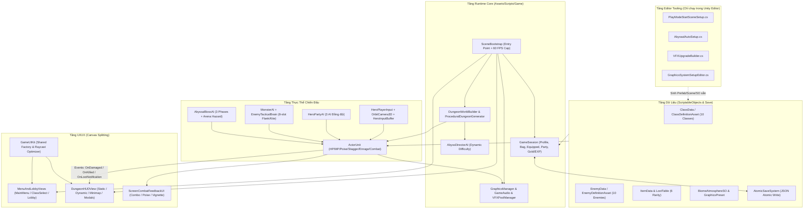
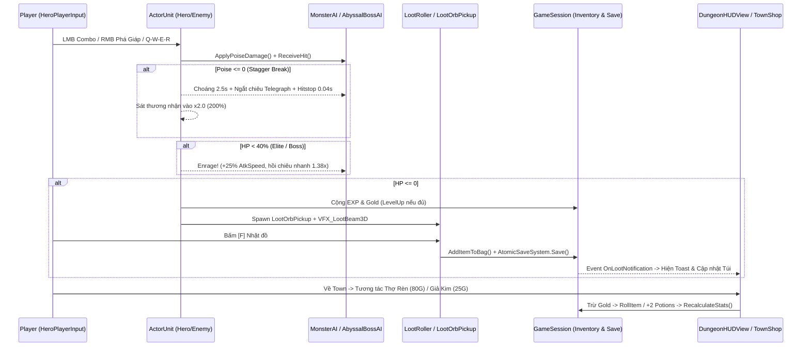

# HƯỚNG DẪN TỰ DỰNG LẠI DỰ ÁN & BẢO VỆ ĐỒ ÁN: ABYSSAL DUNGEON 3D

> **Phiên bản Unity:** `Unity 2021.3 LTS` (thực tế: `2021.3.45f2`) • **Render Pipeline:** `Universal Render Pipeline (URP 12.1)`  
> **Mục tiêu cấu hình tối ưu:** Chạy mượt `60 FPS` ngay cả trên GPU tầm thấp (`NVIDIA GeForce MX350 2GB VRAM`)  
> **Đối tượng sử dụng:** Sinh viên làm đồ án tốt nghiệp/môn học Game Programming muốn hiểu sâu toàn bộ kiến trúc `Abyssal_Dungeon_3D`, tự tay dựng lại thủ công trong Unity Editor từ bộ asset sẵn có và bảo vệ đồ án đạt điểm tối đa trước hội đồng.

---

## MỤC LỤC NHANH
1. [PHẦN 1: BẢN ĐỒ TÀI NGUYÊN (ASSET INVENTORY & MAPPING)](#phần-1-bản-đồ-tài-nguyên-asset-inventory--mapping)
2. [PHẦN 2: QUY TRÌNH DỰNG GAME CHUẨN TỪNG BƯỚC TRONG UNITY EDITOR](#phần-2-quy-trình-dựng-game-chuẩn-từng-bước-trong-unity-editor)
3. [PHẦN 3: GIẢI MÃ KIẾN TRÚC CODE & LUỒNG HOẠT ĐỘNG](#phần-3-giải-mã-kiến-trúc-code--luồng-hoạt-động)
4. [PHẦN 4: CHECKLIST KIỂM THỬ & TỐI ƯU HIỆU NĂNG (QA & OPTIMIZATION)](#phần-4-checklist-kiểm-thử--tối-ưu-hiệu-năng-qa--optimization)
5. [PHẦN 5: KỊCH BẢN THUYẾT TRÌNH & 12 CÂU HỎI PHẢN BIỆN CỦA GIẢNG VIÊN](#phần-5-kịch-bản-thuyết-trình--12-câu-hỏi-phản-biện-của-giảng-viên)
6. [PHẦN 6: PHỤ LỤC TRA CỨU NHANH INSPECTOR & PHÍM TẮT KIỂM THỬ](#phần-6-phụ-lục-tra-cứu-nhanh-inspector--phím-tắt-kiểm-thử)

---

# PHẦN 1: BẢN ĐỒ TÀI NGUYÊN (ASSET INVENTORY & MAPPING)

Toàn bộ tài nguyên thực tế trong project nằm trong thư mục `Assets/`, được chia làm **2 vùng chính**:
- **Vùng nguồn nghệ thuật gốc (`Assets/Art/`, `Assets/Audio/`, `Assets/Shaders/`)**: Chứa file model/prefab xuất từ gói asset gốc, FBX VFX dựng từ Blender, animation clip, texture, material, âm thanh `.wav` và shader URP.
- **Vùng đóng gói chạy thật (`Assets/Resources/`, `Assets/Prefabs/`, `Assets/ScriptableObjects/`, `Assets/Settings/`)**: Chứa các Prefab đã chuẩn hóa scale/collider/animator, ScriptableObjects dữ liệu game, và cấu hình URP.

---

## 1.1. 3D Models, Kiến trúc Modular, Props, Loot & Vũ khí

### A. Bộ kiến trúc Dungeon Modular & Props tương tác
Hai thư mục song song chứa cùng bộ 28 mảnh kiến trúc đã chuẩn hóa pivot/scale:
- Bản gốc xuất: `Assets/Art/Exported/Environment/`
- Bản chuẩn hóa dùng trực tiếp để kéo thả vào Scene (hoặc load qua `Resources.Load`): `Assets/Resources/EnvironmentKit/` và `Assets/Prefabs/Environment/`

| Nhóm công dụng | Tên Prefab thực tế (`Assets/Resources/EnvironmentKit/` & `Assets/Art/Exported/Environment/`) | Vai trò trong Map 3D |
| :--- | :--- | :--- |
| **Sàn & Cầu thang** | `DungeonFloor_ChannelTile.prefab` (`Env_DungeonFloor.prefab`, `Env_DungeonFloorAlt.prefab`), `StoneStairs_Grand.prefab` (`Env_StoneStairs.prefab`) | Lát nền phòng hầm ngục theo lưới modular, tạo cầu thang phân tầng cao thấp. |
| **Tường, Cột & Vòm** | `DungeonWall_Modular.prefab` (`Env_DungeonWall.prefab`), `GothicPillar.prefab` (`Env_GothicPillar.prefab`), `GothicArchVault.prefab` (`Env_GothicArchVault.prefab`), `GothicGateFrame.prefab` | Dựng vách bao phòng, hàng cột Gothic chịu lực, khung vòm hành lang nối phòng. |
| **Cửa & Cổng dịch chuyển** | `IronPortcullis.prefab` (`Env_IronPortcullis.prefab`), `AbyssalPortal.prefab` (`Env_AbyssalPortal.prefab`), `EscapeFloorPortal.prefab` (`Env_EscapeFloorPortal.prefab`) | Cổng song sắt đóng/mở khi khóa phòng chiến đấu; cổng dịch chuyển sang tầng tiếp theo hoặc về thị trấn. |
| **Rương báu, Bàn thờ & Đền hồi máu** | `TreasureChest_IronboundBase.prefab` + `TreasureChest_IronboundLid.prefab`, `HealingShrinePedestal.prefab` (`Env_HealingShrine.prefab`), `RunicPillarAltar.prefab` (`Env_RunePillarAltar.prefab`), `BossThroneAltar.prefab` | Rương mở nắp rơi trang bị; Đài hồi phục HP/MP; Trụ câu đố cổ ngữ; Ngai vàng Boss cuối. |
| **Bẫy & Vật trang trí (Props)** | `SpikeTrapPlate.prefab`, `SpikeCluster.prefab`, `FireBrazierGrate.prefab`, `WallTorchSconce.prefab`, `GuardianStatue_Gothic.prefab`, `AbyssalCrystalCluster.prefab`, `AncientRuins_Rubble.prefab`, `CursedTreeRoot.prefab` | Bẫy gai & bẫy lửa theo chu kỳ; Đuốc gắn tường; Tượng đá Gothic; Tinh thể phát sáng; Đổ nát và rễ cây bị nguyền. |
| **Vật phẩm rơi 3D (Loot Props)** | `Equip_Helmet_Gothic.prefab` (`Loot_Helm.prefab`), `Equip_Armor_Cuirass.prefab` (`Loot_ArmorBox.prefab`), `Equip_Ring_Signet.prefab` (`Loot_GemRing.prefab`), `Equip_Amulet_Talisman.prefab` (`Loot_SkullTalisman.prefab`), `Weap_Knight_RunicLongsword.prefab`, `Enemy_Elite_AffixCrownBanner.prefab` | Mô hình 3D đại diện cho Mũ, Giáp, Nhẫn, Dây chuyền, Vũ khí rơi trên sàn và cờ vương miện trên đầu Quái Tinh Anh. |

> **Lưu ý:** Trong `Assets/Prefabs/Dungeon/` còn có 10 Prefab gameplay dựng sẵn có gắn script tương tác (`Altar.prefab`, `Chest.prefab`, `Crystal.prefab`, `Door.prefab`, `HealingShrine.prefab`, `Pillar.prefab`, `Portal.prefab`, `Torch.prefab`, `Trap_Fire.prefab`, `Trap_Spike.prefab`).

### B. Kho Vũ khí 3D (`Assets/Art/Exported/Weapons/`)
Gồm **20 Prefab vũ khí** gắn vào xương tay phải (`RH_WP`) và tay trái (`LH_WP`) của nhân vật và quái vật:
- **Cho 10 Class Hero:** `Wpn_KnightSword.prefab`, `Wpn_KnightShield.prefab`, `Wpn_GuardianMace.prefab`, `Wpn_GuardianShield.prefab`, `Wpn_BerserkerGreatsword.prefab`, `Wpn_AssassinBladeR.prefab`, `Wpn_AssassinBladeL.prefab`, `Wpn_RangerBow.prefab`, `Wpn_MageStaff.prefab`, `Wpn_ClericHammer.prefab`, `Wpn_ClericShield.prefab`, `Wpn_MonkGloves.prefab`, `Wpn_WarlockSword.prefab`, `Wpn_WarlockBook.prefab`, `Wpn_DruidStaff.prefab`.
- **Cho Quái vật & Boss:** `Wpn_GoblinShovel.prefab`, `Wpn_SkeletonSword.prefab`, `Wpn_SkeletonShield.prefab`, `Wpn_DarkKnightSword.prefab`, `Wpn_GargoyleSword.prefab`, `Wpn_BossShield.prefab`.

---

## 1.2. Characters, Monsters & Animations

### A. 10 Lớp Nhân vật chính (Heroes / Players)
- **Model Rig gốc:** `Assets/Art/Exported/Characters/HeroRig_<ClassName>.prefab` (12 file: `Assassin`, `Berserker`, `BerserkerAlt`, `Cleric`, `Druid`, `DruidBeast`, `Guardian`, `Knight`, `Mage`, `Monk`, `Ranger`, `Warlock`).
- **Prefab hoàn chỉnh (có vũ khí & Animator):**
  - `Assets/Resources/Models/Heroes/Hero_<ClassName>.prefab` (được `CharacterVisualFactory` tải khi chạy runtime).
  - `Assets/Prefabs/Classes/Hero_<ClassName>.prefab` và `Assets/Prefabs/Player/Player_<ClassName>.prefab`.
- **Animation Clips:** `Assets/Art/Exported/Animations/Heroes/<ClassName>/` và `Assets/Art/Exported/Animations/Heroes/Common/` (chứa các clip Idle, Walk, Run, Attack, Cast, Dodge, Jump, Hit, Death).
- **Animator Controllers:** `Assets/Resources/Animators/HeroAnimator_<ClassName>.controller` (10 file theo từng Class + 1 file chung `HeroAnimator.controller`).

### B. 10 Loại Quái vật, Triệu hồi & Boss cuối (`Abyssal Knight`)
| Nhóm | Tên Model gốc (`Assets/Art/Exported/Enemies/`) | Prefab Runtime (`Assets/Resources/Models/Enemies/` & `Assets/Prefabs/Enemy/`) | Animator Controller (`Assets/Resources/Animators/`) | Animation Clips (`Assets/Art/Exported/Animations/Enemies/<Tên>/`) |
| :--- | :--- | :--- | :--- | :--- |
| **Quái Thường (Melee)** | `Mst_Goblin.prefab`, `Mst_Skeleton.prefab`, `Mst_Zombie.prefab`, `Mst_ForestMonster.prefab` | `Enemy_Goblin`, `Enemy_Skeleton`, `Enemy_Zombie`, `Enemy_ForestMonster` | `EnemyAnimator_Goblin.controller`, `..._Skeleton`, `..._Zombie`, `..._ForestMonster` | 7 clip/loài: `Idle`, `Walk`, `Run`, `Attack`, `Cast`, `Hit`, `Death` |
| **Quái Đánh Xa / Pháp Sư (Ranged/Mage)** | `Mst_GoblinArcher.prefab`, `Mst_SkeletonMage.prefab` | `Enemy_GoblinArcher`, `Enemy_SkeletonMage` | `EnemyAnimator_GoblinArcher.controller`, `EnemyAnimator_SkeletonMage.controller` | 7 clip/loài: `Idle`, `Walk`, `Run`, `Attack`, `Cast`, `Hit`, `Death` |
| **Quái Chống Chịu (Tank)** | `Mst_SkeletonWarrior.prefab`, `Mst_CrystalGolem.prefab` | `Enemy_SkeletonWarrior`, `Enemy_CrystalGolem` | `EnemyAnimator_SkeletonWarrior.controller`, `EnemyAnimator_CrystalGolem.controller` | 7 clip/loài: `Idle`, `Walk`, `Run`, `Attack`, `Cast`, `Hit`, `Death` |
| **Quái Tinh Anh / Sát Thủ (Elite/Assassin)** | `Mst_DarkKnight.prefab`, `Mst_Demon.prefab` | `Enemy_DarkKnight`, `Enemy_Demon` | `EnemyAnimator_DarkKnight.controller`, `EnemyAnimator_Demon.controller` | 7 clip/loài: `Idle`, `Walk`, `Run`, `Attack`, `Cast`, `Hit`, `Death` |
| **Triệu Hồi / Hóa Thú** | `Mst_SoulMinion.prefab` (+ `HeroRig_DruidBeast.prefab`) | `Enemy_SoulMinion`, `Hero_DruidBeast` | `EnemyAnimator_SoulMinion.controller`, `EnemyAnimator_DruidBeast.controller` | 7 clip/loài |
| **Boss Cuối (3 Phase)** | `Boss_AbyssalKnight.prefab` | `Assets/Prefabs/Boss/Boss_AbyssalKnight.prefab` & `Assets/Resources/Models/Enemies/Boss_AbyssalKnight.prefab` | `BossAnimator_AbyssalKnight.controller` | `AbyssalKnight_Idle`, `Walk`, `Run`, `Attack`, `Cast`, `Hit`, `Death` |

---

## 1.3. Materials, Shaders & Hệ thống VFX 3D

### A. Materials & Textures
1. **Material kiến trúc PBR (`Assets/Art/Materials/`):**
   - `M_GothicStone.mat`, `M_CathedralFloor.mat`, `M_MossyRuins.mat`, `M_AgedOakWood.mat`, `M_WroughtIron.mat`, `M_RunicGold.mat` (đều dùng shader `Universal Render Pipeline/Lit`).
2. **Material nhân vật & quái (`Assets/Art/Exported/Materials/`):**
   - Các file `MAT_G1P_FitM_*`, `MAT_G1P_RagF_*`, `MAT_G1P_SknM_*`, `MAT_G1P_Bos_SkullKing_*`, `MAT_G1P_Elt_SkKnight_*`, `MAT_G1P_Mst_*` liên kết với bộ texture `.tga` tại `Assets/Art/Exported/Textures/` theo quy ước hậu tố:
     - `_C_` / `_CA_` / `_D_` → **Base Map (Albedo)**
     - `_NM_` / `_NS_` → **Normal Map** (nhớ set Texture Type = `Normal map` trong Inspector!)
     - `_EEI_` → **Emission Map** (phát sáng mắt/giáp Boss & Tinh Anh)

### B. Danh sách 7 Custom URP Shaders thực tế trong Project
| Đường dẫn file | Tên Shader trong Unity Inspector | Công dụng |
| :--- | :--- | :--- |
| `Assets/Resources/Shaders/AbyssalCharacterRimLit.shader` | `AbyssalDungeon/CharacterRimLit` | Lighting nhân vật/quái kèm **viền sáng Fresnel (Rim Light)** giúp nhìn rõ đường nét trong hầm ngục tối. |
| `Assets/Resources/Shaders/AbyssalCrystalLit.shader` | `AbyssalDungeon/CrystalLit` | Shader tinh thể phát quang có hiệu ứng phản xạ cạnh và Emission HDR. |
| `Assets/Resources/Shaders/AbyssalGroundMist.shader` | `AbyssalDungeon/GroundMist` | Sương mù mặt đất cuộn theo UV. |
| `Assets/Resources/Shaders/AbyssalSkillVfx.shader` | `AbyssalDungeon/SkillVfxAdditive` | Hiệu ứng kỹ năng phát sáng cộng màu (Additive) hỗ trợ UV Scrolling. |
| `Assets/Resources/Shaders/AbyssalTorchFlame.shader` | `AbyssalDungeon/TorchFlame` | Ngọn lửa đuốc dao động bằng vertex/UV animation không cần nhiều particle. |
| `Assets/Resources/Shaders/AbyssalWeaponTrail.shader` | `AbyssalDungeon/WeaponTrail` | Vệt chém vũ khí mượt theo combo. |
| `Assets/Shaders/AbyssalVFX_URP.shader` | `AbyssalDungeon/AbyssalVFX_URP` | Shader URP VFX chính cho bộ 7 Mesh VFX 3D dựng từ Blender (Additive/Alpha, UV Panning, HDR Bloom, Fresnel). |

### C. Cách xử lý lỗi hồng Material (Pink Shader) hoặc thiếu Map khi tự dựng
1. **Lỗi Material bị màu hồng cánh sen (Magenta):** Xảy ra khi Material vẫn đang trỏ về `Standard` (Built-in RP) hoặc thiếu shader.
   - **Cách sửa thủ công:** Chọn Material → ở thanh `Shader` trên cùng Inspector đổi sang `Universal Render Pipeline/Lit` (cho môi trường, nhân vật, quái) hoặc `Universal Render Pipeline/Particles/Unlit` / `AbyssalDungeon/AbyssalVFX_URP` (cho VFX).
   - **Sửa hàng loạt trong Unity 2021.3 URP:** `Window → Rendering → Render Pipeline Converter → Built-in to URP → tích Material Upgrade → Initialize Converters → Convert Assets`.
2. **Lỗi nhân vật bị đen hoặc không nổi khối trong hầm ngục tối:**
   - Gán lại `_BaseMap` từ `Assets/Art/Exported/Textures/TEX_*_C_*.tga` và `_BumpMap` từ `TEX_*_NM_*.tga`.
   - Kiểm tra Texture Normal Map trong Inspector: **Texture Type** bắt buộc là `Normal map` → bấm **Apply**.
   - Nếu muốn viền sáng tách nền trên MX350 vẫn ổn định: ưu tiên `Universal Render Pipeline/Lit` kết hợp 1 Light `Point Light` mềm trên nhân vật, hoặc dùng `AbyssalDungeon/CharacterRimLit` đã kiểm chứng biên dịch sạch trên URP 12.1.

### D. Bộ 7 Mesh VFX 3D (dựng từ Blender) & 22 VFX Prefabs
- **Meshes 3D (`Assets/Art/VFX/Meshes/`):** `VFX_HolyPillar.fbx`, `VFX_EnergyDome.fbx`, `VFX_AngelWings.fbx`, `VFX_ShockwaveSlam.fbx`, `VFX_EntangleRoots.fbx`, `VFX_SpiralVortex.fbx`, `VFX_LootBeam3D.fbx` (cột sáng 3D rớt đồ theo 6 bậc phẩm chất).
- **Textures VFX (`Assets/Art/VFX/Textures/` & `Assets/Resources/VFX/Textures/`):** `T_VFX_EnergyFlow.png`, `T_VFX_GroundCracks.png`, `T_VFX_RuneCircle.png`, `T_VFX_SoftParticle.png`, `T_Vfx_SlashCrescent.png`, `T_Vfx_Lightning.png`, `T_Vfx_FrostFlower.png`...
- **Materials VFX (`Assets/Resources/VFX/Materials/`):** 19 Material theo 4 chủ đề màu (`Cleric` Vàng Kim, `Knight` Vàng/Thép, `Mage` Xanh/Tím Arcane, `Ranger` Xanh Ngọc Lục Bảo).
- **Prefabs VFX (`Assets/Resources/VFX/Prefabs/` & `Assets/Prefabs/VFX/`):** `VFXPoolManager.prefab` + 21 VFX kỹ năng (`VFX_Cleric_*`, `VFX_Knight_*`, `VFX_Mage_*`, `VFX_Ranger_*`, `VFX_Projectile_*`, `VFX_Common_SpiralDash`, `VFX_GroundTelegraph_Rune`).

---

## 1.4. Âm thanh (`Assets/Audio/`)

| Thư mục | Danh sách file thực tế (`.wav`) | Thời điểm phát trong game |
| :--- | :--- | :--- |
| **Nhạc nền BGM (`Assets/Audio/Music/`)** | `bgm_mainmenu.wav`, `bgm_town.wav`, `bgm_dungeon.wav`, `bgm_boss.wav`, `bgm_victory.wav`, `bgm_defeat.wav` | MainMenu/Lobby/ClassSelection, Thị trấn Aether Haven, Khám phá Dungeon, Đấu Boss Abyssal Knight, Màn hình Thắng/Thua. |
| **Âm thanh môi trường (`Assets/Audio/Ambience/`)** | `amb_ancient_dungeon.wav`, `amb_forgotten_temple.wav`, `amb_underground_fortress.wav`, `amb_abyssal_cave.wav`, `amb_cursed_forest.wav`, `amb_crystal_chamber.wav`, `amb_boss_arena.wav` | Phát loop theo từng trong 7 Biome hầm ngục. |
| **Hiệu ứng SFX (`Assets/Audio/SFX/`)** | `sfx_attack.wav`, `sfx_hit.wav`, `sfx_crithit.wav`, `sfx_magic.wav`, `sfx_explosion.wav`, `sfx_dodge.wav`, `sfx_shield.wav`, `sfx_heal.wav`, `sfx_bossroar.wav`, `sfx_trap.wav`, `sfx_door.wav`, `sfx_loot.wav`, `sfx_levelup.wav`, `sfx_click.wav` | Đòn chém/bắn, trúng đòn thường/chí mạng, tung phép, nổ AoE, né đòn, bật khiên, hồi máu, tiếng gầm cảnh báo Telegraph/Enrage, bẫy kích hoạt, mở cổng, nhặt đồ/mua rèn đồ, lên cấp, bấm nút UI. |

---

## 1.5. Dữ liệu `ScriptableObjects`, `Prefabs`, `Resources` & `Settings`

- **`Assets/ScriptableObjects/` (80+ file `.asset` mẫu):**
  - `Biomes/` (7 file): `Biome_AncientDungeon.asset` → `Biome_BossArena.asset` (`BiomeAtmosphereSO`: lưu màu Fog, Ambient Light, Directional Light, Post-processing profile theo từng tầng).
  - `Classes/` (20 file): Bộ 10 file `ClassData` (`Knight.asset`..`Druid.asset`) và 10 file `ClassDefinitionAsset` (`CD_Knight.asset`..`CD_Druid.asset`) lưu chỉ số gốc (`baseHP`, `baseMana`, `attack`, `defense`, `attackSpeed`, `criticalChance`, `movementSpeed`), vũ khí, nội tại.
  - `Skills/` (40 file): `SD_<Class>_Skill1..4.asset` (`SkillData`: mana, cooldown, damage multiplier, AoE radius, hiệu ứng trạng thái).
  - `Enemies/` (10 file): `Goblin.asset`, `GoblinArcher.asset`, `Skeleton.asset`, `SkeletonWarrior.asset`, `SkeletonMage.asset`, `Zombie.asset`, `ForestMonster.asset`, `CrystalGolem.asset`, `DarkKnight.asset`, `Demon.asset` (`EnemyData`: HP, ATK, DEF, tốc độ, tầm phát hiện, tầm đánh, EXP/Gold thưởng, `LootTable`).
  - `Items/` (10 file): `IronSword.asset`, `SteelArmor.asset`, `ShadowHelm.asset`, `RingOfPower.asset`, `AmuletOfTheAbyss.asset`, `DemonSlayer.asset`, `AbyssalBlade.asset`, `MythicCrown.asset`, `HealthPotion.asset`, `ManaPotion.asset` (`ItemData`: 6 bậc phẩm chất, 8 chỉ số bonus, giá bán `sellPrice`).
  - `LootTables/` (3 file): `NormalEnemyLoot.asset`, `EliteEnemyLoot.asset`, `BossLoot.asset` (`LootTable`: tỷ lệ rơi từng item + khoảng Gold/EXP chắc chắn rơi).
- **`Assets/Resources/UI/`**: Bộ sprite Gothic cắt sẵn (`Panels/UI_Panel_*.png`, `Buttons/UI_Btn_*.png`, `Classes/*.png`, `Icons/ItemIcons_Sheet.png` + `icon_wpn_*.png`, `Fonts/`).
- **`Assets/Resources/GraphicsPresets/` & `Assets/Settings/Graphics/`**: 5 preset đồ họa URP (`Low`, `Medium`, `High`, `Ultra`, `Cinematic`). Riêng GPU MX350 2GB tự động chọn `GraphicsPreset_Low.asset` + `URP_Low.asset` (`60 FPS`, Shadow tiết kiệm VRAM).

---

# PHẦN 2: QUY TRÌNH DỰNG GAME CHUẨN TỪNG BƯỚC TRONG UNITY EDITOR

> **Nguyên tắc vàng khi tự dựng lại để bảo vệ đồ án:** Tắt hoặc tách bỏ các script tự sinh trong `Assets/Editor` (nếu muốn chứng minh mình tự dựng tay trên Scene thật), tạo Scene mới thủ công, kéo thả từng Prefab vào Hierarchy, cấu hình từng Component trên Inspector rồi lưu Prefab Variant.

---

## BƯỚC 1: Thiết lập Scene, Build Settings & Xây dựng Map Dungeon 3D

### 1.1. Tách biệt Scene & Cấu hình `Build Settings`
1. Tạo (hoặc mở) các Scene trong `Assets/Scenes/`:
   - `MainMenu.unity` (Màn hình chính, nền 3D Gothic + UI Menu)
   - `ClassSelection.unity` (Chọn 1 trong 10 Class + bệ xoay xem model 3D)
   - `Lobby.unity` (Sảnh tổ đội 1 Người chơi + 3 AI / LAN Co-op)
   - `Town.unity` (Thị trấn Aether Haven có NPC Thợ Rèn & Giả Kim Thuật Sư)
   - `Dungeon.unity` (Màn chơi hầm ngục chiến đấu chính)
   - `EndGame.unity` (Tổng kết Victory / Defeat)
2. Vào **File → Build Settings...** và kéo thả đúng thứ tự Index:
   - `0`: `Assets/Scenes/MainMenu.unity`
   - `1`: `Assets/Scenes/ClassSelection.unity`
   - `2`: `Assets/Scenes/Lobby.unity`
   - `3`: `Assets/Scenes/Dungeon.unity`
   - `4`: `Assets/Scenes/EndGame.unity`
   - `5`: `Assets/Scenes/Town.unity`
   - `6`: `Assets/Scenes/VisualShowcase.unity`

### 1.2. Lắp ghép Map Dungeon 3D thủ công từ Modular Kit
1. Trong `Dungeon.unity`, tạo Empty GameObject `--- ENVIRONMENT ---`, bên trong tạo các nhóm con: `Room_01_Entrance`, `Room_02_Combat`, `Room_03_Elite`, `Room_04_BossArena`.
2. Bật chế độ **Grid Snapping** trên Scene View (phím tắt `Ctrl` khi kéo hoặc bật biểu tượng nam châm, đặt bước lưới `Grid Size = 2m` hoặc `4m`).
3. Kéo thả từ `Assets/Resources/EnvironmentKit/`:
   - Lát sàn bằng `DungeonFloor_ChannelTile` (đặt `Y = 0`), đảm bảo mỗi ô sàn có **Box Collider** phẳng.
   - Dựng 4 vách tường bao quanh bằng `DungeonWall_Modular` + nối góc bằng `GothicPillar`.
   - Tại cửa thông giữa 2 phòng, đặt `GothicGateFrame` + `IronPortcullis` (gắn `DoorController.cs` hoặc `BoxCollider` để đóng cửa khi đang đánh quái trong phòng).
   - Đặt `WallTorchSconce` cách nhau `6–8m`, đặt `TreasureChest_IronboundBase/Lid` ở góc phòng thưởng, `HealingShrinePedestal` ở phòng nghỉ, `BossThroneAltar` ở cuối `Room_04_BossArena`.
4. Đánh dấu **Static** (tích `Navigation Static`, `Contribute GI`, `Occluder Static`) cho toàn bộ Sàn, Tường, Cột, Tượng đá (tuyệt đối **không** tích Static cho Cửa đóng mở, Rương mở nắp, Bẫy).

### 1.3. Ánh sáng (Lighting) & Post-Processing (URP)
1. **Directional Light:** Intensity `0.45–0.75`, màu ánh trăng lạnh `(#9FB4D6)`, `Shadow Type = Soft Shadows` (chỉ bật đổ bóng cho đèn chính để tiết kiệm GPU MX350).
2. **Point Lights (Đuốc tường):** Màu cam ấm `(#FF9B42)`, `Range = 8–10m`, `Intensity = 2.0–2.8`, **`Shadow Type = No Shadows`** (tránh vượt giới hạn shadow atlas trên URP).
3. **Environment Lighting (`Window → Rendering → Lighting → Environment`):**
   - `Environment Lighting Source = Color`, chọn màu tối sâu `(#1A1C28)` tạo độ tương phản Chiaroscuro.
   - Bật **Fog**: Mode `Exponential Squared`, Density `0.018–0.025`, màu `#10121C`.
4. **Global Volume (Post-Processing):** Tạo `GameObject → Volume → Global Volume`, gán Profile (`Assets/Settings/SampleSceneProfile.asset`), bật:
   - `Tonemapping`: Mode = `ACES`
   - `Bloom`: Threshold = `1.05`, Intensity = `0.35–0.5` (vừa đủ phát sáng VFX & Tinh thể mà không chói mắt)
   - `Vignette`: Intensity = `0.25`

### 1.4. Thiết lập Điểm Hồi Sinh (Spawn Points) & Nướng NavMesh
1. Tạo các Empty Object đánh dấu vị trí:
   - `PlayerSpawnPoint` tại tâm `Room_01_Entrance` (`Y = 0.05`).
   - `EnemySpawnPoints` (`Room2_Spawn_1..5`, `Room3_EliteSpawn`, `Room4_BossSpawn`).
2. **Nướng NavMesh (`Window → AI → Navigation`):**
   - Tab **Agents**: `Agent Radius = 0.5`, `Agent Height = 2.0`, `Step Height = 0.45`, `Max Slope = 42`.
   - Tab **Object**: Chọn toàn bộ sàn & cầu thang → tích `Navigation Static`, `Navigation Area = Walkable`. Chọn tường, cột, bàn thờ → tích `Navigation Static`, `Navigation Area = Not Walkable`.
   - Cửa `IronPortcullis`: gắn component **NavMeshObstacle** (`Carve = true`, `Carve Only Stationary = true`) để khi cửa đóng quái không chạy xuyên qua, khi mở quái tự đi qua được.
   - Tab **Bake** → bấm **Bake**. Kiểm tra lớp phủ màu xanh lam (Blue NavMesh) phủ kín sàn và **không bị đứt gãy** ở ngưỡng cửa/cầu thang.

---

## BƯỚC 2: Xây dựng Nhân vật chính (Player) & Đóng gói Prefab

### 2.1. Dựng cấu trúc Hierarchy của Player
1. Tạo Empty GameObject tên `Player_Knight` (Layer: `Default` hoặc `Player`, Tag: `Player`, Scale `(1, 1, 1)`).
2. Kéo model `Assets/Art/Exported/Characters/HeroRig_Knight.prefab` làm **con** của `Player_Knight` tại `Local Position (0, 0, 0)`, `Local Rotation (0, 0, 0)`, `Local Scale (1, 1, 1)`.
3. Gắn vũ khí: tìm xương tay phải `RH_WP` (hoặc `mixamorig:RightHand`) trong cây xương của `HeroRig_Knight` → kéo `Wpn_KnightSword.prefab` vào làm con; tìm `LH_WP` → kéo `Wpn_KnightShield.prefab` vào.
4. Tạo child `WeaponHitboxPoint` đặt phía trước nhân vật `(0, 1.1, 1.2)` để làm điểm gốc quét sát thương.

### 2.2. Cấu hình Vật lý (`CharacterController`)
- Gắn component **CharacterController** lên `Player_Knight`:
  - `Center = (0, 1.0, 0)`
  - `Radius = 0.45`
  - `Height = 2.0`
  - `Slope Limit = 45`, `Step Offset = 0.35`, `Skin Width = 0.06`
- *Lưu ý kỹ thuật:* Không gắn `Rigidbody` non-kinematic chung với `CharacterController` để tránh xung đột lực đẩy. Mọi di chuyển đọc Input ở `Update()`, tính vận tốc vật lý và gọi `Controller.Move(...)` đồng bộ trong `FixedUpdate()` để nhân vật không bao giờ bị giật khung hình.

### 2.3. Thiết lập `Animator Controller` (`HeroAnimator_Knight.controller`)
Mở `Window → Animation → Animator` và cấu hình đúng **9 Parameters** mà `ActorUnit.cs` và `CharacterMotionPolisher.cs` điều khiển:
- `Speed` (`Float`, default `0`)
- `LocoSpeedMult` (`Float`, default `1`)
- `IsGrounded` (`Bool`, default `true`)
- `Attack` (`Trigger`)
- `Cast` (`Trigger`)
- `Dodge` (`Trigger`)
- `Jump` (`Trigger`)
- `Hit` (`Trigger`)
- `IsDead` (`Bool`, default `false`)

**Cấu trúc State & Transition chuẩn:**
1. **Locomotion (Default State — Blend Tree 1D theo `Speed`):**
   - `Speed = 0.0` → Clip `Idle`
   - `Speed = 0.5` → Clip `Walk`
   - `Speed = 1.0` → Clip `Run`
   - Gắn `Speed Multiplier Parameter = LocoSpeedMult`.
2. **Any State → `Attack`** (Condition: `Attack` Trigger, `Has Exit Time = false`, Transition Duration `0.08s`) → **`Attack` → `Locomotion`** (`Has Exit Time = true`, Exit Time `0.85`).
3. **Any State → `Cast`** (Condition: `Cast` Trigger, Duration `0.08s`) → **`Cast` → `Locomotion`** (`Has Exit Time = true`).
4. **Any State → `Dodge`** (Condition: `Dodge` Trigger, Duration `0.05s`) → **`Dodge` → `Locomotion`** (`Has Exit Time = true`).
5. **Any State → `Jump`** (Condition: `Jump` Trigger) → **`Jump` → `Locomotion`** (Condition: `IsGrounded == true`).
6. **Any State → `TakeDamage`** (Condition: `Hit` Trigger) → **`TakeDamage` → `Locomotion`** (`Has Exit Time = true`).
7. **Any State → `Death`** (Condition: `IsDead == true`, `Can Transition To Self = false`) — không nối ngược ra `Locomotion`.

### 2.4. Gắn Camera & Script điều khiển
1. Chọn `Main Camera`: gắn `OrbitCamera3D.cs` (hoặc `ThirdPersonCamera.cs`):
   - `Target` = kéo `Player_Knight` vào.
   - `Distance = 7.8`, `Pitch = 24`, `PivotOffset = (0, 1.55, 0)`.
   - Toàn bộ bám theo nhân vật đặt trong `LateUpdate()` dùng `Vector3.SmoothDamp` + `SphereCastNonAlloc` chống xuyên tường.
2. Trên `Player_Knight`, gắn các script:
   - `ActorUnit.cs` (chỉ số HP/MP/Stamina/Poise, Combat, Skill, Dodge i-frame `0.34s`).
   - `HeroPlayerInput.cs` (đọc WASD, chuột LMB/RMB, Q/W/E/R, Space, H, F, I, Esc).
   - `CharacterMotionPolisher.cs` (nghiêng thân khi rẽ, hiệu ứng bóng mờ khi né, sync animation).
   - `HeroInputBuffer.cs` (bộ đệm input `0.15s` giúp combo mượt tay).
   - `HeroSkillVfxBinding.cs` (gán Prefab VFX 3D cho 4 kỹ năng Q/W/E/R).
3. Kéo `Player_Knight` từ Hierarchy vào `Assets/Prefabs/Player/` để đóng gói thành Prefab.

---

## BƯỚC 3: Xây dựng Hệ thống Quái vật, AI & Cơ chế Chiến đấu (Combat & VFX)

### 3.1. Dựng Prefab Quái vật & Boss
1. Tạo Empty GameObject `Enemy_DarkKnight` (Tag: `Enemy`).
2. Kéo `Assets/Art/Exported/Enemies/Mst_DarkKnight.prefab` làm con tại `(0,0,0)`. Gán `EnemyAnimator_DarkKnight.controller` cho component `Animator`.
3. Gắn `CharacterController` (Radius `0.48`, Height `2.0`, Center `(0, 1.0, 0)`) **hoặc** `NavMeshAgent` (`Speed = 4.2`, `Angular Speed = 360`, `Acceleration = 12`, `Stopping Distance = 2.0`, `Radius = 0.5`).
   - *Lưu ý:* Trong bản runtime hiện tại, `ActorUnit` dùng `CharacterController` + né vật cản `HeroPartyAI.ObstacleAvoidDir`, còn bản component modular (`EnemyController.cs`) dùng `NavMeshAgent`. Khi tự dựng lại trên map tĩnh, bạn có thể dùng `NavMeshAgent` để tận dụng trọn vẹn NavMesh đã nướng ở Bước 1!
4. **Hitbox & Hurtbox:**
   - **Hurtbox:** Chính `CapsuleCollider` / `CharacterController` trên thân quái (Layer `Enemy`).
   - **Hitbox:** Gắn `CombatHitboxSystem.cs` (quét `Physics.OverlapSphere` / `OverlapCapsule` trong frame active của đòn đánh, lưu `HashSet<ActorUnit>` để mỗi nhát chém chỉ gây sát thương 1 lần/mục tiêu).

### 3.2. Cấu hình Inspector & Hiểu bản chất 3 Script AI cốt lõi
Gắn lên Quái thường/Tinh Anh: `ActorUnit.cs` + `MonsterAI.cs`. Gắn lên Boss: `ActorUnit.cs` + `AbyssalBossAI.cs`.

| Script AI | Cơ chế thực tế trong code & Tham số cần nắm khi cấu hình / bảo vệ |
| :--- | :--- |
| **`EnemyTacticalBrain.cs`** *(Tầng Điều phối Chiến thuật)* | - **Chia 8 Slot bao vây (`ComputeTacticalEngagePoint`):** Gán tuần tự `_nextSurroundSlot = (_nextSurroundSlot + 1) % 8` cách nhau `45°` quanh mục tiêu, giúp đàn quái cận chiến tản ra bao vây 360° thay vì xếp hàng 1 nối đuôi nhau. - **Assassin Rear-Flank:** Quái sát thủ (`Goblin`, `Demon`) tính điểm sau lưng `-target.forward * 1.65m` để chém lén `+25%` sát thương. - **Tank Bodyguard:** Quái chống chịu (`SkeletonWarrior`, `CrystalGolem`) tự đứng chắn giữa Hero và đồng đội VIP (`Elite`/`Mage`) đồng thời bơm giáp `Guard Link`. - **4 Elite Affixes (`RollEliteAffix`):** *Vampiric* (Hút máu), *Thorns* (Phản 18% sát thương cận chiến), *MoltenDeath* (Nổ lửa khi chết), *ArcaneShielded* (Khiên 35% MaxHP & giảm 25% sát thương nhận cho đến khi bị Phá Giáp). |
| **`MonsterAI.cs`** *(FSM 8 trạng thái cho 10 loài quái)* | - **State Machine:** `Idle → Patrol → Detect → SelectTarget → Chase → Attack → Evaluate → Retreat`. - **Ranged Kiting:** `GoblinArcher` và `SkeletonMage` khi thấy Hero áp sát `< 5.8m` lập tức chuyển sang `Retreat` lùi giữ khoảng cách và lượn ngang (`strafe`). - **Cảnh báo Telegraph (`1.10s–1.25s`):** Quái Tinh Anh (DarkKnight, Demon, CrystalGolem, GoblinArcher Elite...) hiện vòng/vệt đỏ phát sáng `GroundTelegraphFx` + âm thanh báo hiệu trước khi đập/xung kích, ép người chơi phải Né (`Space` i-frame `0.34s`) hoặc đánh Phá Giáp (`RMB/X`). - **Enrage (`< 40% HP`):** Khi `ActorUnit.IsEnraged == true`, `_specialCd` hồi nhanh hơn `1.38x` và `AtkSpeed` tăng `+25%`. |
| **`AbyssalBossAI.cs`** *(Boss 3 Phase + Arena Hazard)* | - **Phase 1 (`100%–66% HP`):** Luân phiên `Shield Bash`, `Xung Kích Vực Thẳm`, `Chém Kiếm Hắc Ám` (Telegraph `1.05s–1.20s`). - **Phase 2 (`66%–33% HP`):** Bật khiên + hào quang tím, mở khóa `Sóng Trảm Hắc Ám` (5 tia), `Bùng Nổ Vực Thẳm` (`1.35s`), `Triệu Hồi Quân Đoàn Xương`. - **Phase 3 (`< 33% HP`) & Enrage (`< 40% HP`):** Biến đổi đấu trường (`SpawnArenaTransformation` tạo 12 vòng lửa thiêu đốt rìa ngoài), mở khóa `Mưa Thiên Thạch` (`1.25s`), tăng tốc đánh `+25%` và hồi chiêu nhanh `1.38x`. - **Cắt chiêu bằng Phá Giáp (Stagger):** Mọi callback gây sát thương của Boss đều kiểm tra `if (_self.IsStaggered) return;` — phá vỡ thanh Poise (`360`) sẽ lập tức ngắt chiêu, choáng **`2.5s`**, kích hoạt **Hitstop `0.04s`** + **Camera Shake** và nhận **`200%` sát thương**! |

### 3.3. Bảng cân bằng chỉ số Quái (`ActorUnit.InitMonster`)
- **Quái thường:** `tierHp = 2.8x`, `tierAtk = 1.80x`, `MaxPoise = 65`.
- **Quái Tinh Anh (Elite):** `tierHp = 5.2x`, `tierAtk = 1.92x`, `MaxPoise = 135`, có 1 `EliteAffix`.
- **Mini-Boss:** `tierHp = 5.8x`, `tierAtk = 2.05x`, `MaxPoise = 220`, scale `1.32x`.
- **Boss cuối:** `tierHp = 5.5x`, `tierAtk = 1.85x`, `MaxPoise = 360`.

---

## BƯỚC 4: Cơ chế Ăn điểm, Nhặt vật phẩm, Túi đồ (Inventory) & Mua bán (Shop)

### 4.1. Luồng dữ liệu hoàn chỉnh (End-to-End Economy Flow)
1. **Tiêu diệt Quái (`ActorUnit.HandleZeroHp`):**
   - Cộng `EXP` và `Gold` trực tiếp vào `GameSession.I.Profile` (nếu đủ EXP tự động tăng Level, cộng `+3 Stat Points` & `+1 Skill Point`, hồi đầy máu/mana và phát `sfx_levelup`).
   - Gọi `LootRoller.RollItem(floor, minRarity, luckBonus)` (hoặc `LootTable.Roll()` trong lớp ScriptableObject) để tung xúc xắc rơi trang bị thuộc 6 bậc phẩm chất: *Common (Trắng) → Uncommon (Lục) → Rare (Lam) → Epic (Tím) → Legendary (Cam) → Mythic (Đỏ)*.
2. **Rớt đồ 3D trên sàn (`LootOrbPickup.Spawn`):**
   - Sinh cột ánh sáng 3D `VFX_LootBeam3D.fbx` mang màu theo bậc phẩm chất + model 3D tương ứng (`Equip_Helmet_Gothic`, `Equip_Armor_Cuirass`, `Weap_Knight_RunicLongsword`...).
   - Người chơi lại gần bấm `[F]` (hoặc tự hút trong bán kính nhặt) → gọi `DungeonWorldBuilder.CollectLootItem(item)` → gọi `GameSession.I.AddItemToBag(item)`.
3. **Lưu trữ & Trang bị (`Inventory` trong `GameSession.cs`):**
   - Lưu danh sách đồ trong `Profile.bag` (không giới hạn cứng số ô nhờ `ScrollRect`) và 5 ô đang mặc trong `Profile.equipped` (`Weapon`, `Armor`, `Helmet`, `Ring`, `Amulet`).
   - Khi bấm **Mặc (`Equip`)**: hoán đổi món cũ về túi, gọi `ActorUnit.RecalculateStats()` cập nhật lại 8 chỉ số (`HP, MP, ATK, DEF, ASPD, Crit, CDR, Lifesteal`) và lưu ngay qua `AtomicSaveSystem` (ghi ra file tạm `.tmp` rồi đổi tên nguyên tử tránh hỏng file save khi tắt đột ngột).
   - Khi bấm **Bán (`SellBagItem`)**: xóa khỏi `Profile.bag`, cộng `sellPrice` Gold vào `Profile.gold`, lưu hồ sơ.
4. **Tương tác NPC Cửa hàng (`TownSceneBuilder` tại `Town.unity`):**
   - **Thợ Rèn Cổ Ngữ (Blacksmith — phía Tây):** Bấm `[F]` tốn `80 Gold` để rèn trang bị bậc Rare+ (`minRarity = 2`), tự động thêm vào túi và cập nhật chỉ số.
   - **Giả Kim Thuật Sư (Alchemist — phía Đông):** Bấm `[F]` tốn `25 Gold` để mua `+2` Bình Hồi Máu (`Profile.potions += 2`).

### 4.2. Hướng dẫn tự tạo & cấu hình `ScriptableObject` chuẩn OOP trong Inspector
1. **Tạo Vật phẩm mới (`ItemData`):**
   - Chuột phải trong Project Window (`Assets/ScriptableObjects/Items/`) → **Create → Abyssal Dungeon → Item Data**.
   - Đặt tên ví dụ `SO_Item_ObsidianGreatsword`.
   - Điền Inspector: `itemName`, `description`, kéo `Sprite` từ `Assets/Resources/UI/Icons/ItemIcons_Sheet.png`, chọn `itemType = Weapon`, `rarity = Epic`, điền 8 chỉ số (`attackBonus = 45`, `criticalChanceBonus = 0.08`, `lifestealBonus = 0.05`...), đặt `sellPrice = 120`.
2. **Tạo Bảng Rớt Đồ (`LootTable`):**
   - Chuột phải trong `Assets/ScriptableObjects/LootTables/` → **Create → Abyssal Dungeon → Loot Table**.
   - Đặt `minGuaranteedGold = 35`, `maxGuaranteedGold = 60`, `minGuaranteedEXP = 120`, `maxGuaranteedEXP = 180`.
   - Mở mảng `Entries`, kéo `SO_Item_ObsidianGreatsword` vào và đặt `dropChance = 0.25` (25%).
3. **Tạo Dữ liệu Quái (`EnemyData`) & Gán bảng rớt đồ:**
   - **Create → Abyssal Dungeon → Enemy Data** → điền `maxHP`, `attack`, `defense`, `detectionRange`, `attackRange`, kéo Prefab quái vào `prefab` và kéo `LootTable` vừa tạo vào `lootTable`.
4. **Mở rộng ShopCatalog (chuẩn OOP nếu muốn tự dựng cửa hàng đa món):**
   - Tạo thêm 1 lớp `ShopCatalogSO : ScriptableObject` chứa `List<ShopOffer>` (gồm `ItemData item`, `int buyPrice`, `int stock`), rồi kéo file `.asset` đó vào script `ShopNPC.cs` thay vì hardcode giá `80G`/`25G` trong code.

---

## BƯỚC 5: Xây dựng Hệ thống UI/UX (`Canvas`) chuẩn 60 FPS

### 5.1. Kiến trúc Tách lớp Canvas (Canvas Splitting)
Trong `Dungeon.unity`, **không dồn toàn bộ UI vào 1 Canvas duy nhất** (vì mỗi khi thanh HP/Cooldown đổi 1 pixel, Unity sẽ rebuild lại toàn bộ mesh của hàng trăm nút bấm & khung ảnh tĩnh). Hãy tạo **4 Canvas tách biệt** (cùng `CanvasScaler`: `Scale With Screen Size`, Reference `1920x1080`, `Match = 0.5`, **tắt `Pixel Perfect = false`**):

1. **`DungeonStaticCanvas` (`Sort Order = 8`, có `GraphicRaycaster`):**
   - Chứa khung nền HUD, ảnh chân dung Class, khung thanh kỹ năng `SkillBar` + 8 nút bấm (`LMB`, `RMB/X`, `Q`, `W`, `E`, `R`, `Space`, `H`), 3 nút góc trên phải (`Hành Trang [I]`, `Bản Đồ [M]`, `Tạm Dừng [Esc]`).
2. **`DungeonDynamicHUDCanvas` (`Sort Order = 10`, XÓA `GraphicRaycaster`):**
   - Chứa các thành phần đổi liên tục: thanh fill `HpBar`, `ShieldOverlay`, `MpBar`, `StaBar`, `ExpBar`, thanh máu Tổ đội (`PartyHUD`), thanh máu Boss 3 Phase (`BossHealthPanel`), `ComboCounter`, `TargetPoiseCard`, `DamageVignette`, `LootNotificationPanel`, và các text số đếm ngược Cooldown.
3. **`DungeonMinimapCanvas` (`Sort Order = 11`, XÓA `GraphicRaycaster`):**
   - Chứa `MinimapFrame` + `RawImage` Radar cập nhật ở tần số `12 Hz` (`0.08s/lần`).
4. **`DungeonModalsCanvas` (`Sort Order = 30`, có `GraphicRaycaster`):**
   - Chứa các cửa sổ bật lên: `CharacterSheetModal` (Hồ sơ + Cây Kỹ Năng + Túi đồ), `FullDungeonMapModal`, `PauseModal`, `SettingsModal`, `ShopModal`. Mặc định **tắt toàn bộ bằng `SetActive(false)`** khi không mở.

### 5.2. Cách dựng Khung Inventory có `ScrollView` không giới hạn vật phẩm
1. Tạo `UI → Scroll View` tên `BagScrollRect` bên trong `CharacterSheetModal`:
   - Tắt `Horizontal`, bật `Vertical`, `Movement Type = Clamped`, `Scroll Sensitivity = 32`.
2. Trên `Viewport`: gắn `RectMask2D` (nhẹ hơn `Mask` vì không dùng Stencil Buffer), giữ `Image.raycastTarget = true` (màu `alpha = 0.01`) để bắt sự kiện lăn chuột.
3. Trên `Content`:
   - Đặt `Pivot = (0.5, 1)` (neo đỉnh trên).
   - Gắn `VerticalLayoutGroup` (`Spacing = 7`, `Child Control Width = true`, `Child Control Height = true`, `Child Force Expand Width = true`, `Child Force Expand Height = false`).
   - Gắn `ContentSizeFitter` (`Vertical Fit = Preferred Size`).
4. Mỗi hàng vật phẩm (`BagItemRow` Prefab) gắn `LayoutElement` (`Min Height = 76`, `Preferred Height = 76`), gồm Icon cắt từ `ItemIcons_Sheet.png`, tên + bậc màu, các pill chỉ số so sánh (`▲+X` xanh lá / `▼-X` đỏ), và 3 nút `Chi Tiết`, `Mặc`, `Bán`.

### 5.3. Cách dựng `MainMenu UI`, `EndGame UI` & Gán sự kiện `OnClick()`
1. **`MainMenu.unity`:** Tạo `MainMenuCanvas` (`1920x1080`), dựng cột trái gồm Logo, thẻ Thợ Săn hiện tại và các nút:
   - `BtnPlay` → Inspector `Button.OnClick()` kéo `MainMenuUI` → chọn `OnPlayClicked()` (chuyển sang `Lobby` hoặc `Dungeon`).
   - `BtnClasses` → `OnClassSelectClicked()` (chuyển `ClassSelection`).
   - `BtnTown` → `OnTownClicked()` (chuyển `Town`).
   - `BtnSettings` → mở `SettingsModal.SetActive(true)`.
   - `BtnQuit` → gọi `Application.Quit()`.
2. **Quy tắc tắt `Raycast Target` dư thừa:**
   - Chỉ giữ `Raycast Target = true` trên: `Button`, `Toggle`, `Slider`, `Scrollbar`, `InputField`, `ScrollRect/Viewport`, và tấm nền tối mờ (`Dimmer`) chắn click sau Modal.
   - Bắt buộc đặt `Raycast Target = false` trên toàn bộ `Text` / `TextMeshProUGUI`, `Image` trang trí/khung viền/icon, `RawImage` Minimap và thanh Fill máu/mana.

---

# PHẦN 3: GIẢI MÃ KIẾN TRÚC CODE & LUỒNG HOẠT ĐỘNG

## 3.1. Sơ đồ Kiến trúc Tổng quan (Mermaid Diagram)

## 3.2. Sơ đồ Luồng Chiến Đấu → Rớt Đồ → Túi Đồ → Cửa Hàng

## 3.3. Bảng tóm tắt các nhóm Script quan trọng trong `Assets/Scripts/`

| Thư mục / Nhóm Script | Các file tiêu biểu | Vai trò thực tế |
| :--- | :--- | :--- |
| **`Scripts/Game/Core/`** | `SceneBootstrap.cs`, `GameSession.cs`, `GameDefs.cs`, `AtomicSaveSystem.cs`, `GameObjectPool.cs` | Khởi tạo Scene, giữ dữ liệu xuyên màn (`DontDestroyOnLoad`), bảng chỉ số 10 Class/10 Enemy, lưu file JSON an toàn, Object Pooling. |
| **`Scripts/Game/Combat/`** | `ActorUnit.cs`, `HeroPlayerInput.cs`, `CombatFeelManager.cs`, `CombatHitboxSystem.cs`, `ScreenCombatFeedbackUI.cs` | Trái tim chiến đấu: di chuyển `FixedUpdate`, Camera `LateUpdate`, Hitstop, Camera Shake, Hitbox sweep, Poise/Stagger 200%, Enrage <40%, i-frame Dodge. |
| **`Scripts/Game/AI/`** | `MonsterAI.cs`, `AbyssalBossAI.cs`, `EnemyTacticalBrain.cs`, `HeroPartyAI.cs`, `EnemyDefinitionAsset.cs` | AI FSM 8 trạng thái cho 10 loại quái, điều phối bao vây 8-slot/kiting/affix, Boss 3 Phase, và 3 đồng đội AI tự đánh/hồi máu/né đòn. |
| **`Scripts/Game/Dungeon/`** | `DungeonWorldBuilder.cs`, `ProceduralDungeonGenerator.cs`, `AbyssDirectorAI.cs` | Sinh hầm ngục phân nhánh nhiều phòng (Entrance, Combat, Puzzle, Treasure, Elite, MiniBoss, Boss), rớt đồ 3D, câu đố trụ cổ ngữ, và AI Director điều chỉnh độ khó động. |
| **`Scripts/Game/UI/`** | `GameUIKit.cs`, `DungeonAndEndViews.cs`, `MenuAndLobbyViews.cs`, `DungeonOverlayPanelsUI.cs`, `UIButtonGothicFX.cs` | Toàn bộ giao diện Ancient Gothic: Canvas Splitting 4 lớp, dirty-check text, throttle 0.1s cooldown, Minimap 12Hz, Inventory ScrollView, Town Shop. |
| **`Scripts/Game/Graphics/` & `Environment/`** | `GraphicsManager.cs`, `AdaptiveQualityController.cs`, `PerformanceMonitor.cs`, `ModularDungeonArchitect.cs`, `AbyssalPostProcessing.cs` | Tự nhận diện phần cứng (MX350 → preset Low 60 FPS), điều chỉnh Render Scale động, quản lý Post-Processing và 7 Biome. |
| **`Scripts/VFX/`** | `VFXPoolManager.cs`, `VFXAnimatedLayerController.cs`, `HeroSkillVfxBinding.cs` | Pool hóa 21 VFX kỹ năng 3D đa lớp (Mesh + Decal + Particle), tránh `Instantiate`/`Destroy` gây giật GC giữa trận. |
| **`Scripts/Core, Player, Enemy, Loot, Classes, UI/`** | `GameManager.cs`, `PlayerController.cs`, `EnemyController.cs`, `BossController.cs`, `ItemData.cs`, `LootTable.cs`, `ClassData.cs` | **Lớp kiến trúc Modular Component & ScriptableObject chuẩn OOP** (tách nhỏ từng trách nhiệm) dùng trực tiếp khi bạn kéo thả dựng lại thủ công trên Scene. |

## 3.4. Phân biệt **Editor Tooling tự động hóa** vs **Runtime Gameplay Logic**
Đây là điểm cực kỳ quan trọng để bạn giải thích rõ ràng với giảng viên:
- **Editor Tooling (`Assets/Editor/PlayModeStartSceneSetup.cs`, `Assets/Editor/VFXUpgradeBuilder.cs`, `Assets/Scripts/Game/Editor/AbyssalAutoSetup.cs`, `GraphicsSystemSetupEditor.cs`):**
  - Được bọc trong `#if UNITY_EDITOR` và **không hề được biên dịch vào bản build `.exe` cuối cùng**.
  - Mục đích giống như các công cụ Pipeline trong studio thật: tự động chuẩn hóa import texture Normal Map, tự động nối dây 23 AnimatorController, lắp sẵn 28 Prefab môi trường và đảm bảo khi bấm Play luôn vào từ `MainMenu`. Nó giúp tiết kiệm hàng chục giờ thao tác lặp lại và tránh sai sót quên gán Reference bằng tay.
- **Runtime Gameplay Logic (`Assets/Scripts/Game/...` & `Assets/Scripts/VFX/...`):**
  - Là toàn bộ code chạy thật trong game khi người chơi điều khiển nhân vật, đánh quái, AI ra quyết định, tính sát thương, rơi đồ, lưu file và hiển thị UI.

---

# PHẦN 4: CHECKLIST KIỂM THỬ & TỐI ƯU HIỆU NĂNG (QA & OPTIMIZATION)

| # | Lỗi thường gặp khi tự dựng lại | Nguyên nhân gốc | Cách kiểm tra & Khắc phục triệt để |
| :-: | :--- | :--- | :--- |
| 1 | **NullReferenceException khi vừa bấm Play** | Quên kéo Reference vào Inspector (`Target` của Camera, `LootTable` của Enemy, `Text`/`Image` của HUD) hoặc vào thẳng `Dungeon.unity` mà chưa có `GameSession`. | Kiểm tra dòng lỗi trong Console → click đúp mở đúng dòng code; dùng `PlayModeStartSceneSetup` để luôn khởi động từ `MainMenu.unity`; bổ sung `if (ref == null) return;` phòng thủ. |
| 2 | **Material bị hồng cánh sen hoặc nhân vật tàng hình/đen** | Asset cũ dùng Built-in `Standard` shader thay vì `URP/Lit`, hoặc Normal Map chưa set `Texture Type = Normal map`, hoặc thiếu ánh sáng môi trường. | Chạy `Render Pipeline Converter → Material Upgrade`; kiểm tra shader của `SkinnedMeshRenderer` là `Universal Render Pipeline/Lit`; kiểm tra `Layer` nhân vật nằm trong `Culling Mask` của `Main Camera`. |
| 3 | **Quái đứng yên hoặc kẹt vào tường/cửa** | Sàn chưa tích `Navigation Static`, chưa bấm **Bake NavMesh**, hoặc cửa `IronPortcullis` thiếu `NavMeshObstacle (Carve = true)`. | Mở `Window → AI → Navigation`, nhìn Scene View phải thấy lưới màu xanh lam liên tục qua các cửa; kiểm tra `Agent Radius (0.5)` nhỏ hơn nửa chiều rộng hành lang. |
| 4 | **Nhân vật di chuyển bị giật dần theo thời gian** | Trộn lẫn vật lý `Controller.Move` trong `Update()` không đồng bộ với Camera, hoặc tích tụ Coroutine / Event Listener không gỡ khi đổi phòng. | Đọc Input ở `Update()`, xử lý di chuyển ở `FixedUpdate()`, Camera Follow ở `LateUpdate()` bằng `SmoothDamp`; luôn hủy đăng ký event (`-=`) trong `OnDestroy()`. |
| 5 | **Click chuột / xoay Camera bị kẹt do UI che** | Quên tắt `Raycast Target` trên khung trang trí/Text/Vignette toàn màn hình, hoặc không khóa/mở `Cursor.lockState` khi bật/tắt Modal. | Chạy `GameUIKit.OptimizeCanvasHierarchy(canvas)` tắt toàn bộ `raycastTarget` không phải nút bấm; đồng bộ `OrbitCamera3D.UIBlockingCursor` mỗi khi mở/đóng popup. |
| 6 | **Lag / tụt FPS khi chiến đấu hoặc mở Túi đồ** | Dồn toàn bộ HUD vào 1 Canvas gây UI Rebuild toàn màn hình; nối chuỗi `.text = "..."` và `new List<string>()` mỗi frame trong `Update()`; spawn VFX bằng `Instantiate`/`Destroy`. | Tách 4 Canvas (`Static`, `Dynamic`, `Minimap`, `Modals`); dùng Dirty-check chỉ gán `.text` khi số thay đổi; throttle text cooldown `0.1s`; dùng `VFXPoolManager` tái sử dụng VFX; đóng popup bằng `SetActive(false)`. |
| 7 | **Quá tải VRAM trên GPU tầm thấp (MX350 2GB)** | Bật Shadow cho quá nhiều Point Light, độ phân giải Shadow Map `4096`, không giới hạn FPS khiến GPU chạy 100%. | Đặt `Application.targetFrameRate = 60`; chỉ bật Shadow cho 1 `Directional Light` chính (`Shadow Resolution = 1024` ở preset Low); bật `EnvironmentDistanceCuller` ẩn props xa; kích hoạt `SRP Batcher` trên URP Asset. |

---

# PHẦN 5: KỊCH BẢN THUYẾT TRÌNH & 12 CÂU HỎI PHẢN BIỆN CỦA GIẢNG VIÊN

## 5.1. Dàn ý Thuyết trình chuẩn (5–7 phút)

- **Phút 0:00 – 1:00 | Giới thiệu & Vòng lặp Gameplay (Game Loop):**
  - Giới thiệu *Abyssal Dungeon 3D*: Game Action RPG Dark Fantasy 3D (Unity 2021.3 URP), hỗ trợ 1 Người chơi + 3 AI đồng đội (hoặc LAN Co-op).
  - Trình bày Core Loop rõ ràng: `MainMenu → Chọn Class (10 hệ phái) → Sảnh Tổ Đội (Lobby) / Thị trấn (Town) → Vào Hầm ngục nhiều phòng → Đánh Quái & Boss 3 Phase → Rớt trang bị 6 phẩm chất → Nâng cấp Build / Rèn đồ → Chinh phục tầng sâu hơn`.
- **Phút 1:00 – 2:30 | Demo trực tiếp (Live Gameplay — 1.5 phút):**
  - Bấm Play từ `MainMenu` → qua `ClassSelection` xoay xem model 3D → vào `Dungeon`.
  - Diễn họa thực tế: Combo LMB 3 nhịp, Né đòn `Space` xuyên vùng đỏ Telegraph của Quái Tinh Anh, tung đòn Phá Giáp `RMB/X` kích hoạt **Stagger 2.5s (Hitstop + Camera Shake + 200% sát thương)**, hạ quái rớt cột sáng 3D `VFX_LootBeam3D`, bấm `[I]` mở Túi đồ so sánh chỉ số (`▲/▼`) và mặc trang bị.
- **Phút 2:30 – 4:00 | Kiến trúc Phần mềm & Hệ thống AI:**
  - Chiếu sơ đồ Mermaid kiến trúc tách lớp (Data `ScriptableObjects` — Runtime Core — Combat/AI — UI Canvas Splitting).
  - Nhấn mạnh điểm sáng kỹ thuật: **EnemyTacticalBrain** (chia 8 slot bao vây 360°, Ranged kiting, Tank bảo vệ VIP, 4 Elite Affixes), **Boss 3 Phase** (Enrage `<40% HP`, cắt chiêu bằng Stagger), và **AbyssDirectorAI** (điều chỉnh độ khó động theo phong độ tổ đội).
- **Phút 4:00 – 5:30 | Tối ưu Hiệu năng & Technical Art (URP + MX350):**
  - Trình bày 4 kỹ thuật tối ưu thực chiến: (1) **Canvas Splitting 4 lớp** + tắt `Raycast Target`/`Pixel Perfect` + Dirty-check UI & throttle cooldown `0.1s`; (2) **Object Pooling (`VFXPoolManager`)** cho 21 VFX 3D dựng từ Blender; (3) **URP Adaptive Quality** tự nhận diện GPU MX350 chọn preset Low `60 FPS`; (4) **Atomic Save System** chống hỏng file save.
- **Phút 5:30 – 6:30 | Kết luận & Hướng phát triển:**
  - Tổng kết kết quả đạt được (0 lỗi Console, chạy ổn định 60 FPS, kiến trúc mở rộng dễ thêm Class/Enemy/Item qua ScriptableObject) và mời hội đồng đặt câu hỏi.

---

## 5.2. 12 Câu hỏi "xoáy" thường gặp từ Giảng viên & Câu trả lời chuẩn kỹ thuật

### Câu 1: *Tại sao em dùng `ScriptableObject` cho Item, Class, Enemy, LootTable thay vì lưu cứng trong code hay dùng JSON thuần?*
> **Trả lời chuẩn:** `ScriptableObject` là đối tượng dữ liệu gốc của Unity được serialize thành asset `.asset` trên ổ đĩa: (1) **Tách biệt Data khỏi Logic** (nguyên lý Open/Closed trong SOLID) — Game Designer có thể tạo thêm kiếm, quái, bảng rớt đồ ngay trên Inspector mà không sửa 1 dòng code; (2) **Tiết kiệm RAM (Flyweight Pattern)** — 50 con Goblin trong phòng cùng trỏ vào 1 `EnemyData` duy nhất thay vì nhân bản dữ liệu; (3) **An toàn kiểu dữ liệu & kéo thả trực tiếp Reference** (Sprite, Prefab, AudioClip) mà JSON thuần không làm được. JSON chỉ nên dùng cho **Save dữ liệu động của người chơi** (`AtomicSaveSystem`).

### Câu 2: *Thuật toán tìm đường và phối hợp bao vây của AI hoạt động như thế nào để quái không bị xếp hàng một cục?*
> **Trả lời chuẩn:** Em kết hợp **FSM 8 trạng thái** (`MonsterAI`) với bộ điều phối chiến thuật **`EnemyTacticalBrain`**:
> - Về tìm đường: sử dụng NavMesh / cảm biến né vật cản đa tia (`ObstacleAvoidDir`) để vòng qua cột và tường.
> - Về chống xếp hàng: thay vì mọi quái cận chiến đều lao về đúng tọa độ `target.position`, `ComputeTacticalEngagePoint` phân bổ mỗi quái vào 1 trong **8 slot góc cách nhau `45°`** (`_nextSurroundSlot = (_nextSurroundSlot + 1) % 8`) trên vòng tròn bán kính `AttackRange * 0.78`.
> - Theo vai trò: **Ranged/Mage** (`GoblinArcher`, `SkeletonMage`) chủ động chuyển trạng thái `Retreat` khi Hero áp sát `< 5.8m`; **Assassin** vòng ra sau lưng `-target.forward` để chém lén `+25%`; **Tank** đứng chặn giữa Hero và đồng đội VIP.

### Câu 3: *Cơ chế Combat (Hitbox, Stagger, i-frame Dodge, Hitstop) được thiết kế ra sao để tạo "Game Feel" tốt?*
> **Trả lời chuẩn:**
> - **Input Buffering (`HeroInputBuffer`)**: Ghi nhớ lệnh bấm sớm trước `0.15s` giúp nối combo 3 đòn mượt mà.
> - **Hitbox Sweep (`CombatHitboxSystem`)**: Chỉ mở vùng quét va chạm trong khung hình vung vũ khí và dùng `HashSet<ActorUnit>` chống gây sát thương trùng lặp trong 1 nhát chém.
> - **Risk–Reward Counterplay**: Quái Tinh Anh & Boss báo trước đòn bằng vùng đỏ `GroundTelegraphFx` (`1.05s–1.35s`). Người chơi có 2 lựa chọn kỹ năng: Né bằng `Space` (bật cờ `IsInvincible` trong `0.34s` i-frame) hoặc tung đòn nặng `RMB/X` phá vỡ thanh **Poise** → kích hoạt **Stagger**: ngắt chiêu địch, choáng `2.5s`, **Hitstop `0.04s`** (dùng `WaitForSecondsRealtime` nên không bị treo khi `Time.timeScale` giảm), **Camera Shake**, và gây **`200%` sát thương**.

### Câu 4: *Em tối ưu UI như thế nào để khi mở Túi đồ nhiều trang bị hoặc đang đánh Boss đông hiệu ứng mà game không bị lag?*
> **Trả lời chuẩn:** Có 4 lớp tối ưu trong `DungeonHUDView`, `GameUIKit` và `ScreenCombatFeedbackUI`:
> 1. **Canvas Splitting (Tách 4 Canvas):** Tách `DungeonStaticCanvas` (nút & khung tĩnh), `DungeonDynamicHUDCanvas` (thanh HP/MP/Cooldown, bỏ `GraphicRaycaster`), `DungeonMinimapCanvas` (12 Hz, bỏ `GraphicRaycaster`), và `DungeonModalsCanvas` (các popup). Nhờ đó thanh máu tụt mỗi frame không làm rebuild lại khung nút bấm tĩnh.
> 2. **Tắt `Raycast Target` & `Pixel Perfect`:** Chỉ giữ `raycastTarget = true` cho `Selectable` và `ScrollRect/Viewport`; tắt `pixelPerfect` trên tất cả Canvas để bỏ bước làm tròn đỉnh tốn CPU.
> 3. **Dirty-Check & Throttle `0.1s`:** Không bao giờ gán `.text = $"..."` hay cấp phát `new List<string>()` mỗi frame — chỉ format chuỗi khi giá trị số nguyên đổi, dùng `StringBuilder` tái sử dụng, và cập nhật số đếm ngược Cooldown ở `10 Hz` (`0.1s`).
> 4. **ScrollView + RectMask2D:** Dùng `RectMask2D` thay `Mask` (không tốn Draw Call cho Stencil) và tắt hoàn toàn popup đóng bằng `SetActive(false)`.

### Câu 5: *Làm sao tối ưu Draw Calls, VRAM và hiệu năng 3D/VFX để chạy mượt 60 FPS trên laptop card yếu (MX350 2GB)?*
> **Trả lời chuẩn:**
> - **SRP Batcher của URP:** Dùng chung shader `Universal Render Pipeline/Lit` cho kiến trúc/nhân vật và `AbyssalVFX_URP.shader` cho toàn bộ 21 VFX 3D để gom batch tự động.
> - **Object Pooling (`VFXPoolManager`, `GameObjectPool`):** Khởi tạo sẵn VFX và tái sử dụng, loại bỏ hoàn toàn spike GC do `Instantiate`/`Destroy` khi 4 nhân vật tung chiêu cùng lúc.
> - **Lighting tiết kiệm:** Chỉ 1 Directional Light đổ bóng; toàn bộ Point Light của đuốc tường đặt `No Shadows`.
> - **Auto-Detect Hardware (`GraphicsManager` + `AdaptiveQualityController`):** Đọc VRAM thực tế khi mở game, tự chọn `GraphicsPreset_Low` (`targetFrameRate = 60`), kết hợp `EnvironmentDistanceCuller` ẩn vật thể xa.

### Câu 6: *Tại sao khi tách Input / Physics / Camera lại phải chia `Update()`, `FixedUpdate()` và `LateUpdate()`?*
> **Trả lời chuẩn:**
> - **`Update()`:** Chạy theo tốc độ khung hình render, lý tưởng để bắt `Input.GetKeyDown` (nếu đặt ở `FixedUpdate` rất dễ bị nuốt phím).
> - **`FixedUpdate()`:** Chạy ở bước thời gian cố định (`0.02s`), đảm bảo tính toán di chuyển vật lý, trọng lực và va chạm `CharacterController` ổn định, không bị phụ thuộc FPS cao hay thấp.
> - **`LateUpdate()`:** Chạy sau khi nhân vật đã cập nhật xong vị trí cuối cùng của frame, nên đặt `OrbitCamera3D` (`Vector3.SmoothDamp`) ở đây sẽ triệt tiêu hoàn toàn hiện tượng rung giật (camera jitter).

### Câu 7: *Trong project có các script trong `Assets/Editor/` tự động dựng Scene/Prefab — vậy phần nào là em tự hiểu và kiểm soát?*
> **Trả lời chuẩn:** Các script trong `Assets/Editor/` (`AbyssalAutoSetup`, `VFXUpgradeBuilder`, `PlayModeStartSceneSetup`) là **Editor Pipeline Tooling** — chỉ chạy trong lúc phát triển để tự động hóa các thao tác thủ công lặp lại (import texture, nối 23 Animator, tạo 21 VFX Prefab, khóa PlayMode mở từ `MainMenu`) và bị loại bỏ hoàn toàn khi build game. Toàn bộ logic gameplay, AI, combat, kinh tế, lưu trữ và giao diện đều chạy ở **Runtime** và em có thể mở bất kỳ Prefab, Animator hay ScriptableObject nào trong Unity Editor để chỉnh sửa hoặc dựng mới thủ công ngay tại buổi bảo vệ.

### Câu 8: *Quy trình tái sử dụng, chuẩn hóa Model 3D, Rig và Animation từ bộ Asset có sẵn được thực hiện ra sao?*
> **Trả lời chuẩn:** (1) Chuẩn hóa **Pivot** dưới chân nhân vật `(0,0,0)` và **Scale** đồng nhất `(1,1,1)` (chiều cao Hero ~`1.8m`, Boss ~`3.2m`); (2) Chuẩn hóa **Material sang URP/Lit** và gán đúng kênh Albedo (`_C_`), Normal (`_NM_` đặt Texture Type = Normal map), Emission (`_EEI_`); (3) Gắn vũ khí chuẩn vào socket xương `RH_WP`/`LH_WP` để vũ khí tự di chuyển theo Animation; (4) Tái sử dụng cùng 1 bộ chuẩn 9 Parameter Animator (`Speed`, `Attack`, `Cast`, `Dodge`, `Hit`, `IsDead`...) cho cả 10 Class và 10 Enemy nên code điều khiển (`ActorUnit`) chỉ cần viết 1 lần dùng chung cho tất cả.

### Câu 9: *Hệ thống Save Game (`AtomicSaveSystem`) chống lỗi hỏng file lưu như thế nào?*
> **Trả lời chuẩn:** Thay vì ghi đè trực tiếp lên file save chính (nếu mất điện hoặc crash giữa chừng sẽ mất trắng dữ liệu), `AtomicSaveSystem` ghi dữ liệu JSON ra file tạm `.tmp`, xác thực ghi xong rồi mới đổi tên/thay thế nguyên tử (atomic replace) sang file chính và giữ thêm bản sao lưu `.bak`. Khi đọc, nếu file chính lỗi thì tự động phục hồi từ `.bak`.

### Câu 10: *AbyssDirectorAI hoạt động theo nguyên lý gì? Khác gì với độ khó cứng (Easy/Normal/Hard)?*
> **Trả lời chuẩn:** Lấy cảm hứng từ AI Director trong *Left 4 Dead*: `AbyssDirectorAI` liên tục theo dõi các chỉ số thực tế của tổ đội (`RecordDamageDealt`, `RecordDamageTaken`, `RecordHealing`, tốc độ dọn phòng, số lần gục) để tính điểm `PerformanceScore (0–100)`. Nếu tổ đội đánh quá áp đảo, Director tự tăng nhẹ hệ số `HpMultiplier`, `AtkMultiplier` hoặc mật độ quái ở phòng kế tiếp; ngược lại nếu tổ đội đang gặp khó khăn, Director giảm áp lực và tăng cơ hội hồi phục — giúp nhịp độ căng thẳng luôn cân bằng ở mọi tầng.

### Câu 11: *Nếu muốn thêm một Class nhân vật thứ 11 hoặc một loại Quái mới, em cần làm những bước nào?*
> **Trả lời chuẩn:** Nhờ kiến trúc Data-Driven: (1) Tạo 1 `ClassData` (hoặc `EnemyData`) `.asset` mới điền chỉ số và 4 `SkillData`; (2) Chuẩn bị Prefab model 3D có gắn Animator dùng chung bộ 9 tham số; (3) Đăng ký ID/Prefab vào bảng dữ liệu (`GameDB` / `Resources/Models/`). Hoàn toàn không cần sửa core loop chiến đấu trong `ActorUnit`, `CombatHitboxSystem` hay `DungeonHUDView`.

### Câu 12: *Tại sao em chọn `CharacterController` thay vì `Rigidbody` cho nhân vật chính Action RPG?*
> **Trả lời chuẩn:** Trong game Action RPG tốc độ cao có Dodge Roll, Lunge (lao tới khi chém) và di chuyển dứt khoát không quán tính trượt, `CharacterController` cho phép kiểm soát vận tốc tức thì, leo bậc thang (`Step Offset`) và sườn dốc (`Slope Limit`) cực kỳ ổn định, không bị xoay lăn hay văng bất thường khi va chạm đàn quái đông như `Rigidbody` vật lý động. Các lực đẩy lùi (`ApplyKnockback`) được mô phỏng tường minh bằng vector `_knockbackVel` giảm dần theo hàm mũ trong `FixedUpdate()`.

---

# PHẦN 6: PHỤ LỤC TRA CỨU NHANH INSPECTOR & PHÍM TẮT KIỂM THỬ

## 6.1. Phím điều khiển Gameplay thực tế (`HeroPlayerInput.cs`)
| Phím | Chức năng |
| :--- | :--- |
| `W / A / S / D` | Di chuyển 8 hướng theo góc nhìn Camera |
| `Shift` / `Alt` | Chạy nhanh (tốn Thể lực) / Đi bộ |
| `Chuột trái (LMB)` | Combo đánh thường 3 nhịp (nhịp 3 Finisher gây sát thương & đẩy lùi lớn) |
| `Chuột phải (RMB)` hoặc `X` | Đòn nặng Vũ khí **Phá Giáp (Guard-Break)** (tốn 20 Thể lực, gây sát thương Poise cao) |
| `Q / W / E / R` (hoặc `1 / 2 / 3 / 4`) | 4 Kỹ năng chủ động & Tuyệt kỹ (Ultimate) của Class |
| `Space` | Né đòn (Dodge Roll — có `0.34s` bất tử i-frame) |
| `Tab` | Khóa mục tiêu (`CameraTargetLockSystem`) |
| `H` | Uống Bình Hồi Máu |
| `F` | Tương tác (Nhặt đồ, Mở rương, Đền hồi máu, Cổng, Thợ Rèn, Giả Kim, Trụ câu đố) |
| `I` / `M` / `Esc` | Mở Hồ sơ & Túi đồ / Bản đồ chiến thuật toàn hầm ngục / Menu Tạm dừng |

## 6.2. Phím tắt Demo / Kiểm thử nhanh trước Hội đồng (`DungeonHUDView.HandleLabTestShortcuts`)
| Phím tắt | Tác dụng kiểm thử nhanh trong `Dungeon.unity` |
| :--- | :--- |
| **`F5`** | Cộng ngay EXP để tăng +1 Level (test hiệu ứng Level Up & bảng cộng điểm `[I]`) |
| **`F6`** | Rơi ngay trang bị ngẫu nhiên kèm cột sáng 3D `VFX_LootBeam3D` trước mặt nhân vật |
| **`F7`** | Dịch chuyển thẳng tới Phòng Boss **Abyssal Knight** để demo 3 Phase & Stagger |
| **`F8`** | Dọn sạch quái trong phòng hiện tại để mở cổng nhanh sang phòng kế tiếp |
